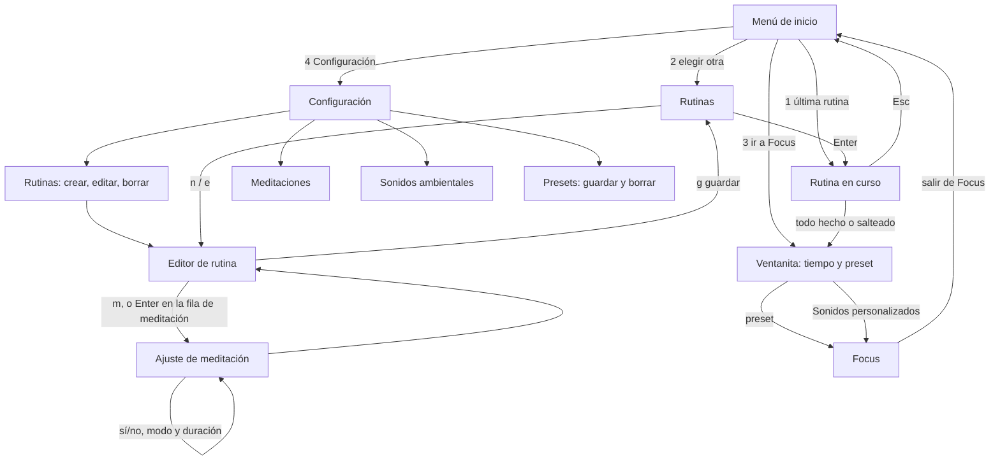

# Diseño v2: estructura y rutina (cerrado 31/10/2026)

Copia de la página de Notion https://app.notion.com/p/40a1e02f1f31813aa4bace3f162fb100. Si cambia, manda Notion.

Versión 2, repensada de cero a partir de "Decisiones: estructura de la app" y actualizada con todas las respuestas de Fabrizio (31/10/2026). La v1 queda como estaba. Es para la PC, en pantallas de terminal; el celular viene cuando se elija la tecnología.

Lo que decidí yo y Fabrizio todavía no validó está marcado como **propuesta** y listado al final.

## Principios que tomé de Apple Design e Impeccable

Solo los que sirven en una terminal (nada de animaciones, gestos ni transparencias):

- **Es una herramienta, no una vidriera.** Lo que importa es que se lea de un vistazo y se use igual siempre. Nada de adornos.
- **Lo común primero.** El camino de todos los días ("empezar con mi rutina de siempre") es un solo `Enter`. Crear y editar quedan un nivel más adentro.
- **Siempre saber dónde estás y cómo salir.** Cada pantalla tiene título arriba y la línea de teclas abajo. `Esc` siempre vuelve un paso atrás, en todas las pantallas.
- **Respuesta al instante.** Cada tecla cambia algo visible en el momento (el paso se tacha, el contador avanza).
- **Deshacer antes que confirmar.** Marcar o saltar un paso se deshace con `u`, sin preguntar. Solo se pide confirmación para lo que no tiene vuelta: borrar una rutina, un paso o una meditación.
- **Mismas teclas que focus.** `↑↓`/`jk` para moverse, `Enter` para elegir, `␣` para marcar, `a` agregar, `d` borrar, `?` ayuda. Lo que se ve igual se comporta igual.
- **Nombres directos.** "Rutinas", "Meditaciones", "Ir a Focus", nada de "Inicio" o "Panel".
- **Sensación buscada: calma.** Pocos colores (uno para lo seleccionado, otro para lo hecho), mucho aire y frases cortas. La rutina va en silencio, salvo la meditación.

## Lo decidido por Fabrizio

- Menú de inicio con 4 opciones: 1) Continuar (empezar de nuevo la última rutina), 2) Elegir otra rutina, 3) Ir directo a Focus, 4) Configuración.
- Configuración es el único lugar para editar rutinas, meditaciones y sonidos ambientales de Focus. Excepción: desde "Elegir otra rutina" también se puede crear y editar una rutina.
- Focus queda 100 % libre de distracciones y minimalista: solo elegir sonidos, volumen y temporizador. Todo lo de agregar o borrar sonidos y opciones parecidas sale de Focus y va a Configuración.
- La lista de Meditaciones se abre desde Configuración.
- Guardar y borrar presets pasa a Configuración. En Focus se saca la tecla `s`.
- Las rutinas se borran desde Configuración y también desde "Elegir otra rutina".
- Si un paso de duración fija se queda sin meditaciones en su categoría, la rutina avisa en ese paso y deja elegir otra duración o saltearlo.
- La meditación se elige al azar puro: puede repetirse.
- En Configuración > Presets, `n` arma un preset eligiendo sonidos y volumen en una vista igual a la de Focus, y se guarda con un nombre.
- Las meditaciones van en una lista aparte de los sonidos de focus.
- Durante la rutina no suenan sonidos de ambiente; solo suena la meditación.
- Un paso se puede saltar con una tecla y queda marcado como salteado.
- Los pasos se marcan en cualquier orden y en cualquier momento. En la rutina en curso la meditación aparece como un paso más, siempre al final de la lista.
- Cuando todos los pasos quedan hechos o salteados, se entra a Focus.
- Siempre que se entra a Focus (después de una rutina o con "Ir a Focus"), primero aparece una ventanita: pregunta cuánto tiempo va a trabajar y arranca el temporizador; después pregunta qué preset de sonidos usar, con una última opción "Sonidos personalizados" que lleva a elegirlos a mano como en Focus hoy.
- Rutinas y meditaciones se sincronizan entre compus con `focus sync`, igual que presets y sonidos.
- `Esc` en la ventanita de tiempo y preset no vuelve al menú: la saltea y entra directo a Focus. Si ya eligió el tiempo y aprieta `Esc` en la parte de sonidos, no arranca nada (ni temporizador) y entra a Focus como hoy.
- Las meditaciones se ordenan solo por duración, en categorías fijas: 5, 10, 15, 20, 25, 30, 40 minutos y 1 hora. Una categoría solo aparece si tiene al menos una meditación. Al bajar una, Fabrizio elige a mano en qué categoría va.
- En la rutina se elige una duración y la app pone una meditación al azar de esa categoría.
- La meditación de una rutina (como máximo una, aparte de las tareas) tiene dos modos: **duración fija** (la duración se elige al armar la rutina y en el momento no pregunta nada) o **duración libre** (en ese paso pregunta qué duración).
- Al salir de Focus se vuelve al menú de inicio.

## Mapa de la app



## Flujos

**Todos los días (el camino corto)**

1. Abre WorkHub y aparece el menú de inicio con la última rutina ya seleccionada.
2. `Enter` y arranca la rutina, en silencio.
3. Se mueve con `↑↓` entre los pasos y los marca en el orden que quiera: `␣` hecho, `s` saltear, `u` deshace lo último.
4. En el paso de meditación, si es de duración libre, primero elige la duración entre las categorías que tienen meditaciones; si es fija, no pregunta. La app pone una meditación al azar de esa duración y `Enter` la reproduce o pausa dentro de la app. Que termine el audio no marca el paso: lo marca él.
5. Cuando todos quedan hechos o salteados, aparece la ventanita de Focus.
6. Elige el tiempo, después el preset (o "Sonidos personalizados") y entra a Focus con el temporizador corriendo. Con `Esc` saltea la ventanita y entra directo a Focus.
7. Al salir de Focus vuelve al menú de inicio.

**Elegir otra rutina**

1. En el menú, opción 2 (o tecla `2`).
2. Lista de rutinas: `Enter` empieza, `n` crea, `e` edita, `d` borra (con confirmación).

**Configuración**

1. En el menú, opción 4 (o tecla `4`).
2. Cuatro entradas: Rutinas, Meditaciones, Sonidos ambientales y Presets.
3. Rutinas: `n` crea, `e` edita, `d` borra (con confirmación).
4. Meditaciones y Sonidos ambientales: `a` agrega desde YouTube, `d` borra (con confirmación).
5. Presets: `n` arma uno nuevo eligiendo sonidos y volumen en una vista igual a la de Focus y lo guarda con un nombre; `d` borra (con confirmación).

**Crear o editar una rutina**

1. Nombre de la rutina.
2. Tareas con `a`: siempre agrega una **tarea** (un texto, como "Preparar mate"), sin preguntar de qué tipo.
3. La **meditación** no es un paso de la lista: es un ajuste aparte, en una fila al final del editor (se abre con `m` desde cualquier lugar, o con `Enter` sobre la fila). Es sí o no, como máximo una por rutina. Si es sí, elige el modo: **duración fija** (y cuál, por ejemplo 10 minutos) o **duración libre** (se elige al hacerla). No se elige un audio puntual: la app pone uno al azar de esa duración.
4. `K`/`J` reordenan las tareas, `g` guarda, `Esc` sale (si hay cambios sin guardar, pregunta).

**Agregar una meditación**

1. En Configuración > Meditaciones, `a` y pega el link de YouTube, igual que los sonidos de focus.
2. Elige a mano la categoría: 5, 10, 15, 20, 25, 30, 40 minutos o 1 hora.
3. `d` borra una meditación (con confirmación).

**Ir directo a Focus**

1. En el menú, opción 3.
2. Aparece la misma ventanita de tiempo y preset (o `Esc` para saltearla), y después Focus.

**Primera vez (sin rutinas)** — propuesta

- El menú no muestra "última rutina": muestra "Crear mi primera rutina" en su lugar, para no ofrecer algo que no existe.

## Pantallas

1. Menú de inicio.
2. Rutinas (lista).
3. Editor de rutina.
4. Ajuste de meditación (sí/no, duración fija o libre).
5. Configuración (Rutinas, Meditaciones, Sonidos ambientales).
5b. Meditaciones (dentro de Configuración, agrupada por duración, con `a` para agregar desde YouTube y elegir categoría).
5c. Sonidos ambientales (dentro de Configuración: agregar desde YouTube y borrar, lo que hoy está en Focus).
5d. Presets (dentro de Configuración: armar, guardar y borrar).
6. Elegir duración (solo en pasos de duración libre, durante la rutina).
7. Rutina en curso.
8. Ventanita de Focus: tiempo y después preset.
9. Confirmaciones: borrar rutina, borrar paso, borrar meditación, salir sin guardar.
10. Focus, minimalista: solo elegir sonidos, volumen y temporizador. Sin agregar ni borrar sonidos, sin guardar ni borrar presets (se sacan `a`, `s` y `d`).

## Bocetos

Menú de inicio:

```javascript
  WorkHub

  > 1  Continuar "Mañana de estudio"
    2  Elegir otra rutina
    3  Ir a Focus
    4  Configuración

  ↑↓ mover · Enter elegir · 1-4 directo · q salir
```

Rutinas:

```javascript
  Rutinas

  > Mañana de estudio      4 pasos · 1 meditación
    Tarde de trabajo       3 pasos

  Enter empezar · n nueva · e editar · d borrar · Esc volver
```

Editor de rutina:

```javascript
  Editar · Mañana de estudio

    1  Ordenar el escritorio
    2  Preparar mate
  > 3  Abrir el material

    Meditación · 10 min fija

  a tarea · Enter editar · K/J mover · d borrar
  g guardar · Esc volver
```

Meditaciones:

```javascript
  Meditaciones

  5 minutos
    Respiración 4-7-8
  10 minutos
  > Calma guiada
    Escaneo corporal

  a agregar desde YouTube · d borrar · Esc volver
```

Solo se ven las categorías con al menos una meditación.

Ajuste de meditación en el editor (con «No» se ocultan el modo y la duración):

```javascript
  Meditación de la rutina

  > Meditación: > Sí     No
    Modo:       > Duración fija     Duración libre
    Duración:     10 minutos

  ←→ cambiar · ↑↓ mover · Enter listo · Esc volver
```

Elegir duración (paso de duración libre, en la rutina):

```javascript
  Meditación · ¿cuánto tiempo?

    5 minutos
  > 10 minutos
    20 minutos

  Enter elegir · Esc volver
```

Rutina en curso (los pasos se marcan en cualquier orden):

```javascript
  Mañana de estudio                  2 de 4 listos

  ✓  Ordenar el escritorio
  –  Preparar mate                  salteado
  >  Meditación 10 min · Calma guiada (al azar)
       ▶ 03:12 / 10:00
     Abrir el material

  ␣ hecho · s saltear · u deshacer · Enter play/pausa
  ↑↓ mover · Esc menú
```

Ventanita de Focus, paso 1 de 2:

```javascript
  ┌ Antes de arrancar · 1 de 2 ──────────┐
  │ ¿Cuánto vas a trabajar?             │
  │                                     │
  │   [ 50 ] minutos                    │
  │                                     │
  │ ↑↓ cambiar · Enter seguir · Esc saltear│
  └─────────────────────────────────────┘
```

Ventanita de Focus, paso 2 de 2:

```javascript
  ┌ Antes de arrancar · 2 de 2 ──────────┐
  │ ¿Qué sonidos?                       │
  │                                     │
  │ > Templo Jedi                       │
  │   Lluvia y fuego                    │
  │   Sonidos personalizados            │
  │                                     │
  │ Enter arrancar · Esc saltear        │
  └─────────────────────────────────────┘
```

Los nombres de rutinas, meditaciones y presets de los bocetos son ejemplos.

## Propuestas mías para validar

Aprobadas por Fabrizio (31/10/2026):

- Sin rutinas, el menú muestra "Crear mi primera rutina" en vez de "última rutina".
- En la ventanita, el tiempo arranca con el último valor usado y se cambia con `↑↓` o escribiéndolo.
- En el editor, guardar es `g` (y no `s`), porque `s` es saltear en la rutina en curso.
- `u` deshace la última marca (hecho o salteado), sin pedir confirmación.
- Si un paso de duración fija se queda sin meditaciones, avisa y deja elegir otra duración o saltearlo.

Rechazada: evitar repetir la meditación anterior (va al azar puro).

- En Configuración > Presets, `n` arma un preset en una vista igual a la de Focus y se guarda con un nombre.

Todavía sin validar: ninguna. **La v2 está cerrada (31/10/2026).**

## Etapa 3 hecha (1/11/2026)

Ventanita de Focus, Configuración > Sonidos ambientales y Presets, y fuera `a`, `s` y `d` de Focus. Lo que el diseño no definía y se resolvió por lo más simple (a validar):

- El tiempo se recuerda al apretar `Enter` en el paso 1, aunque después se salga del paso 2 con `Esc`. `↑↓` mueven de a 5 minutos (mínimo 1, máximo 999); el primer dígito escrito reemplaza el valor.
- «Sonidos personalizados» no apaga lo que ya suena: solo arranca el temporizador.
- Sonidos ambientales lista solo los descargados; los generados (ruidos, binaural) no se agregan ni se borran. Borrar un sonido no lo saca de los presets que lo usan (al cargar el preset se ignora).
- En el armado de presets los sonidos elegidos suenan en vivo con su volumen (decisión de Fabrizio, preview real por el daemon con `SetActive`/`SetVolume`). Al entrar se callan los sonidos de Focus y se guarda qué sonaba; al salir (guardar o `Esc`) se apaga el preview y se restauran sonidos, volúmenes y pausa (sin nada sonando, queda silencio). `␣` elige, `←→` volumen, `g` guarda, `Esc` descarta: sin sonidos elegidos sale directo; con al menos uno pregunta «¿Descartar el preset?» (`s`/`y`/`Enter` descarta, `n`/`Esc` sigue armando). El volumen inicial es el que tiene el sonido en Focus. No deja repetir el nombre de un preset (ni cambiando mayúsculas).
- `q` en la ventanita no hace nada (solo Ctrl+C sale).

## Modo deep work en Focus (1/11/2026)

`d` en Focus prende y apaga el modo (en Focus ya no había otro uso de `d`, y los popups tienen prioridad sobre las teclas de Focus, así que no chocan). En el modo: la escena animada ocupa toda la pantalla, en el centro va el timer (`m:ss`) con la misma fuente de 3 filas del reloj de siempre, escalada por un factor entero (cada medio bloque se repite k veces a lo ancho y a lo alto: misma forma y simetría; k = 2 como máximo, un poco más grande que el reloj normal, o menos si no entra; no crece más en pantallas grandes) y con el mismo degradé y brillo que el reloj de siempre, o «FOCUS» grande si no hay timer; abajo solo `? ayuda`. Si en la ventanita «Antes de arrancar» se elige tiempo y preset, el modo arranca prendido; con «Sonidos personalizados» o `Esc`, no. Las teclas de sonido, volumen, timer, `Esc` y `q` siguen igual. Al llegar el timer a cero estando en el modo: «¡Buen trabajo!» y «presioná d para volver»; `d` vuelve a Focus normal. Fuera del modo no cambia nada. Decisiones por lo más simple (a validar):

- Cómo se sabe que «llegó a cero» y no que lo cancelaron: el daemon manda el estado cada segundo; si el timer desaparece y en el estado anterior quedaban ≤ 2 s, terminó.
- Sale del modo (queda `Off`) al salir de Focus con `Esc` y al volver a entrar a Focus.
- `Esc` en el modo hace lo de Focus normal: vuelve al menú de inicio (no solo sale del modo).
- Los avisos (`notice`) y el volumen general no se ven en el modo; el reloj no tiene barra de progreso ni lista de sonidos.
- Si no entra el reloj grande (terminal chica) se usa el de 3 filas.
- En la pantalla final todas las teclas siguen activas; si se arranca otro timer con `t`, vuelve el reloj.

## Dudas abiertas (para Fabrizio, vía Jefe, de a una)

Ninguna por ahora.
